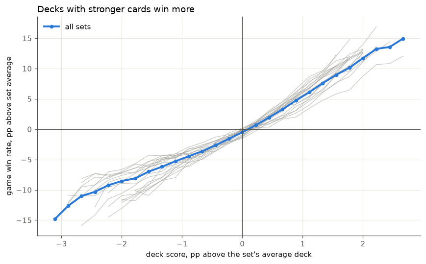
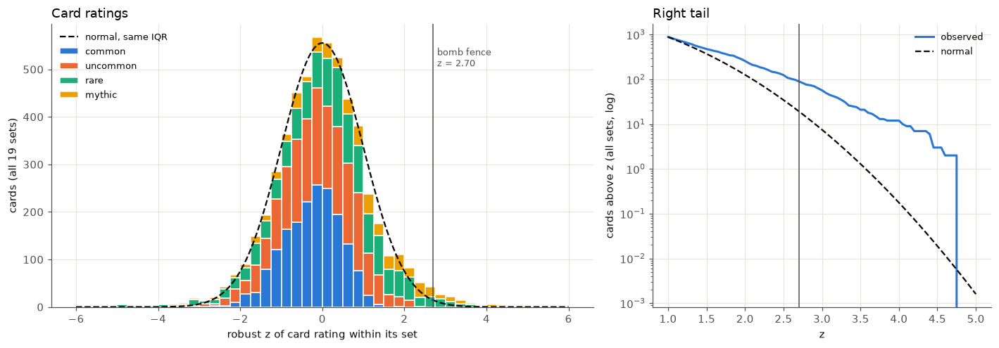
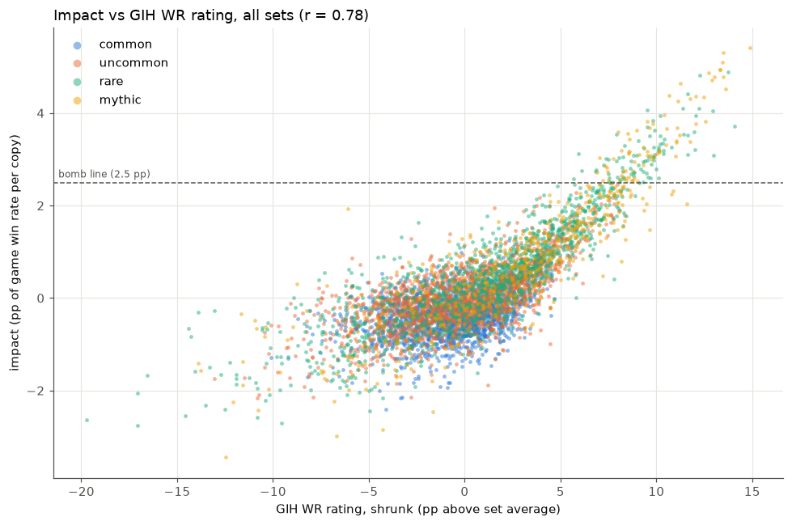
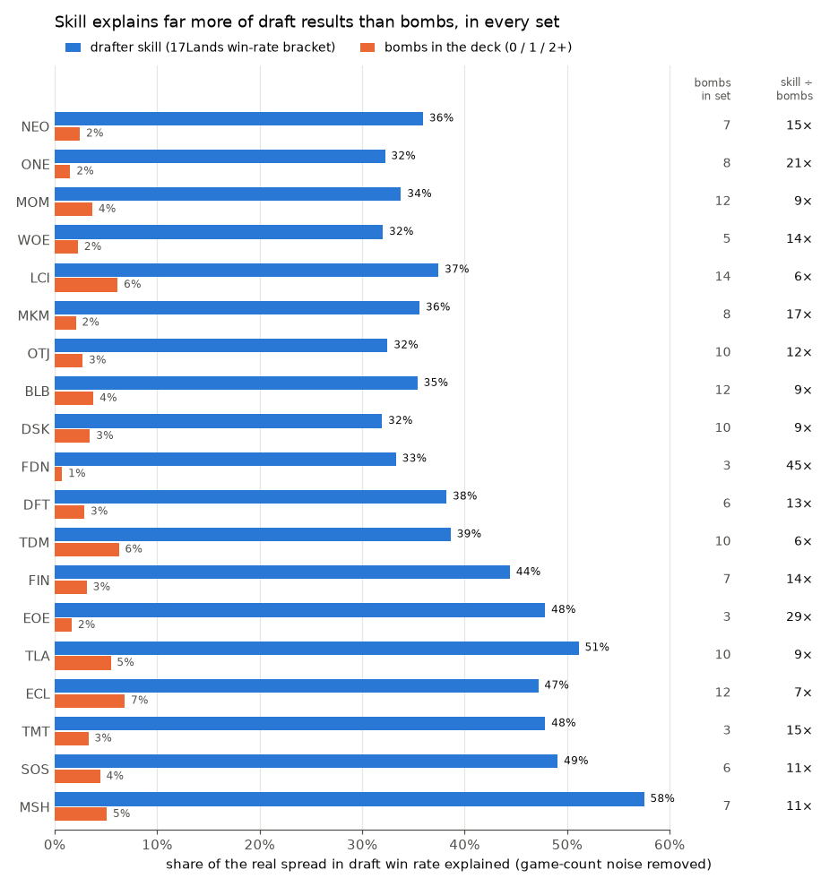
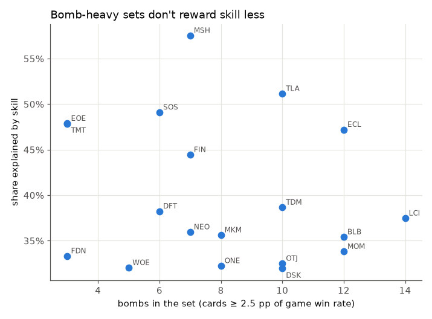
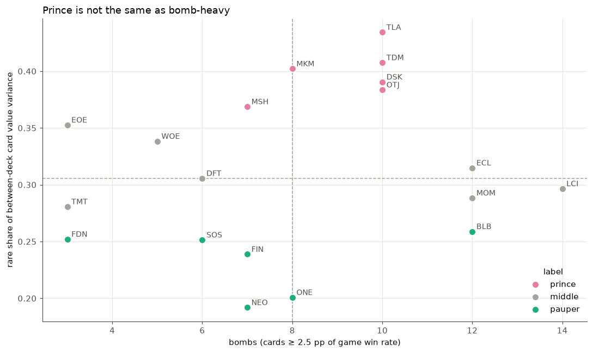
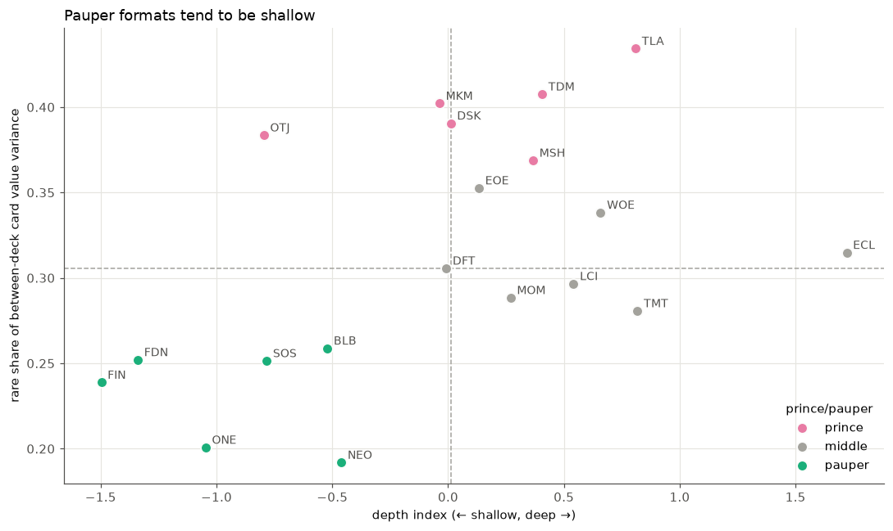

# What Is a Bomb Actually Worth? 14 Million Limited Games Across 19 Sets

*Measuring every set's best cards on the same scale, how often you actually get one, and which formats are decided by rares*

---

Some Magic the Gathering sets are said to be bomb-heavy: there are extremely powerful cards in the set that if played can often win the game. In general, this is said in a derogatory way, as it introduces additional luck into the limited format, thus reducing the impact of player skill. I wanted to use some 17lands data to actually try to empirically answer this question using **19 sets of 17Lands Premier Draft data**, from Kamigawa: Neon Dynasty (Feb 2022) to Marvel Super Heroes, about **14 million games** in total.

To do that, I first needed a definition of a bomb that means the same thing in every set, which turned out to be harder than it sounds. Once I had one, I could count how many bombs each set has, how often you open one, and how often one ends up in your pool. Then I looked at a related idea that Limited players talk about a lot: whether a format is "prince" (decided by rares) or "pauper" (decided by commons and uncommons). It turns out that being bomb-heavy and being prince are not the same thing.

Here's a summary of what I found:

- A set's best card is worth about 4.4 percentage points (pp) of game win rate per copy, compared with an average card in the same deck. The 10th-best card is worth about 2.3 pp.
- If you call a card a bomb when it's worth at least 2.5 pp per copy, a typical set has about 8 bombs. Foundations, Edge of Eternities and TMNT have 3. Lost Caverns of Ixalan has 14.
- About one opened pack in eleven contains a bomb, and you'll open one in your own three packs about a quarter of the time.
- Bomb-heavy sets don't reduce the impact of skill. Skill explains about 10 times as much of the spread in draft results as having bombs does, and that ratio doesn't shrink in sets with more bombs.
- Whether a set is bomb-heavy and whether it's prince barely correlate across sets.

---

## Rating cards

The natural starting point is 17Lands' GIH WR: the win rate of games where a card was in your opening hand or drawn. It needs two adjustments before it can be compared across sets.

First, the baseline moves. 17Lands users are better than the average Arena player, so they win about 55% of their games rather than 50%, and the exact number depends on the set (54.1% in Outlaws of Thunder Junction, 56.8% in TMNT). A 58% GIH WR card is good in one set and only fine in another. So I subtracted each set's average and rated every card in percentage points above its set's baseline.

Second, cards with few games have noisy win rates, and the noisiest cards tend to end up at the very top and bottom of the list. To correct for this, I shrank each card's rating toward the average for its rarity (an empirical Bayes adjustment). Cards with a lot of data barely move, and cards with little data get pulled toward the middle. I shrank toward the rarity average rather than one overall average because mythics are on average several points better than commons, and a single shared average would have dragged the real bombs down.

I also considered using IWD (GIH WR minus the win rate when the card was in the deck but never seen), which is meant to separate a card's effect from the quality of the decks it's in. I tested both by rating each deck as the average rating of its cards and checking which version better predicts wins. GIH WR did better on all 19 sets, so I used it throughout.

## Deck score, and why ratings aren't comparable across sets

For every game, I scored the deck as the average rating of its nonbasic cards. To avoid a deck's own results leaking into its score, I split the drafts into two random halves and scored each half using ratings calculated only from the other half.

*Game win rate by deck score, relative to each set's average. Thin lines are individual sets and the thick line pools them.*

Deck score predicts wins well. A drafter whose decks are one standard deviation better than average wins about 4.6 pp more games, and deck card strength explains about a third of the real differences in drafters' win rates (between 0.20 and 0.47 depending on the set). The other two thirds comes from play skill, mulligans, synergy, and everything else a list of card ratings doesn't capture.

The problem is that the conversion from rating to win rate is different in every set. One point of deck score is worth 3.6 pp of win rate in Phyrexia: All Will Be One and 7.0 pp in Duskmourn.

*Each dot is a set. In sets where deck scores are more spread out, each point of rating is worth less.*

The conversion is lowest in the sets where decks look the most different from each other, and the two effects roughly cancel out. I checked whether a wider spread of opponents could explain this, but in a simple model it only accounts for 1 to 2%, not a factor of two. My best explanation is that the rating scale itself is stretched in some sets: part of the spread in GIH WR comes from which players pick a card, which games it shows up in, and noise, not from how good the card is. When there's more of that, decks look more different than they really are.

This matters for bombs. It means you can't pick a fixed rating cutoff, say 10 pp above the set's baseline, and call everything above it a bomb, because 10 pp of rating is worth a lot more win rate in Duskmourn than in ONE.

## The usual bomb rule, and why it doesn't work across sets

The standard statistical way to call a card a bomb is to call it an outlier within its set. I used the Tukey upper fence: a card is a bomb if its rating is more than 1.5 interquartile ranges above the third quartile. If ratings were normally distributed, about one card per set would clear that bar. In practice 90 cards across the 19 sets do, compared with about 19 expected, so bombs really do stand apart from the rest of their sets.

The fence doesn't have the scale problem, since it measures each card in units of its own set's spread. But that's also its limitation: it's a relative measure. It asks how far a card stands out from the rest of its set, not how much win rate it's worth. A set with a wide spread among its ordinary cards gets a higher bar, so it can have cards that win a lot of games without any of them counting as outliers. Lorwyn Eclipsed is the clearest example: it has the widest spread of common and uncommon values in the data and only 2 fence bombs, but, as the next section shows, 12 cards worth at least 2.5 pp of win rate. So the fence counts (none in Foundations, ten each in Lost Caverns and Avatar) don't tell you how many game-winning cards a set has.

## Measuring bombs in win rate

To put every set on the same scale, I measured each card directly in terms of game win rate. For each card in each set, I ran a regression over every Premier Draft game:

Here g is a game and i is the card:

- won is 1 if the game was won and 0 if it was lost.
- copies is the number of copies of card i in the main deck. Its coefficient, β (beta), is the number I'm after: multiplied by 100, it's the pp of game win rate per copy.
- score is the deck's score with card i left out. Bombs tend to be in decks that are good for other reasons too, so holding this fixed (through γ) means the card is being compared with an average card from the same deck.
- controls are the drafter's overall win-rate bracket from 17Lands (so that "good players take this card" doesn't count as the card being strong), the deck's colors, whether the player was on the play or the draw, and how many rated cards the deck has.
- α is the intercept and ε is the leftover noise.

Standard errors are clustered by draft, cards that appeared in fewer than 500 decks are dropped, and the estimates are again shrunk toward the average for the card's set and rarity. I'll call the result a card's **impact**.

Across sets, the median best card is worth about 4.4 pp per copy, ranging from 3.2 in Foundations to 5.4 in Lost Caverns. The 5th-best card is worth about 3.1 pp and the 10th-best about 2.3. Commons average around −0.4, uncommons around 0, and rares and mythics that nobody called a bomb about +0.3. The best cards are also worth up to about 1.5 times what you'd get by converting their rating through the deck-score slope, and the worst cards cost less than their ratings suggest (they level off around −0.7 pp).

With these numbers I could also check the rating-scale problem from earlier. If the sets with flat rating-to-win-rate conversions really had weaker cards, their best cards would have lower impact. They don't: the impact of each set's 1st, 5th and 10th best card is unrelated to the conversion or the rating spread (correlations between −0.10 and +0.15). So the differences between sets were in the scale, not in how strong the cards are.

### How different is impact from GIH WR?

Impact takes a lot more work to compute than GIH WR, so it's fair to ask how much it changes the picture.

*Each dot is a card. The dashed line is the 2.5 pp bomb cutoff used in the next section.*

Mostly, they agree. Within a set, the correlation between a card's impact and its shrunk GIH WR rating is about 0.79 (from 0.68 in Secrets of Strixhaven to 0.84 in Duskmourn), and each pp of rating is worth about 0.2 pp of impact per copy. Where they disagree:

- **The order in the middle.** The rank correlation is lower, about 0.69. Many cards sit within a pp or two of each other, and the two measures often order them differently. At the top and bottom they line up.
- **The shape at the ends.** The relationship curves upward. The best cards are worth more than a straight line through the rest would predict, which is why converting ratings undersells bombs.
- **Commons.** The correlation is 0.86–0.88 for rares and mythics and 0.68 for uncommons, but only 0.39 for commons. Commons' impacts sit in a narrow band, so a common's GIH WR says little about whether it actually wins more games than the common next to it.

### A definition of a bomb

I defined a bomb as **a card worth at least 2.5 pp of game win rate per copy, compared with an average card in the same deck.**

I chose 2.5 because it falls between a typical set's 5th- and 10th-best cards, and because it lines up well with what the Limited community thinks. I put together a list of the cards the community called bombs in each set, separating calls made before release (set reviews, early tier lists) from calls made after (retrospectives, draft guides). Of the cards called bombs both before and after release, 72% clear 2.5 pp, compared with 2% of all other rares and mythics. Cards that were hyped before release and then downgraded have a median impact of only 0.9 pp, and none of them clear the bar. Post-release opinion is partly based on 17Lands data, so agreement there isn't fully independent, but cards called bombs only before release still have a median impact of 2.2 pp.

By this definition there are 153 bombs across the 19 sets, a median of 8 per set: 70 mythics and 83 rares, and no commons or uncommons. These are the ten strongest:

| Card | Set | Impact (pp per copy) |
|---|---|---|
| Bonehoard Dracosaur | LCI | +5.4 |
| Aclazotz, Deepest Betrayal | LCI | +5.3 |
| Jeskai Revelation | TDM | +5.1 |
| Aurelia's Vindicator | MKM | +4.9 |
| Captain Marvel, Earth's Protector | MSH | +4.9 |
| Gruff Triplets | WOE | +4.9 |
| Jugan Defends the Temple | NEO | +4.9 |
| Marang River Regent | TDM | +4.8 |
| Ugin, Eye of the Storms | TDM | +4.8 |
| Sab-Sunen, Luxa Embodied | DFT | +4.8 |

And here's how the sets compare:

| Bombs | Sets |
|---|---|
| 12–14 | LCI (14), MOM, BLB, ECL (12) |
| 10 | OTJ, DSK, TDM, TLA |
| 6–8 | ONE, MKM (8); NEO, FIN, MSH (7); DFT, SOS (6) |
| 3–5 | WOE (5); FDN, EOE, TMT (3) |

Foundations is the least bomb-heavy set in the data. Its three bombs are Liliana, Dreadhorde General (+3.2), Curator of Destinies (+2.7) and Embercleave (+2.5), and Liliana is the weakest best card of any set. Lost Caverns is at the other end, with 14 cards above 2.5 pp and 11 above 3.

85 of the 90 fence bombs from earlier are also bombs under this definition, so the fence did a good job of identifying great cards. What it misses are strong cards in sets whose ordinary cards are also widely spread, like Lorwyn Eclipsed.

### How often do you see one?

Using 17Lands draft logs, which are available for 17 of the 19 sets, I counted how often packs and pools contain a bomb.

For the median set:

- 9% of opened packs contain a bomb, or about one pack in eleven.
- There's a 25% chance you open at least one in your own three packs.
- There's a 90% chance someone at an 8-player table opens one, and about 2.2 bombs are opened per table on average.
- 28% of 17Lands drafters end up with at least one bomb in their pool, and only 4% end up with two.

So a typical draft has two or three bombs going around the table, and you have about a one-in-four chance of ending up with one. This varies a lot by set. In Foundations and Edge of Eternities only about 10% of drafters finish with a bomb, while in Bloomburrow and Lost Caverns more than 40% do. Across sets, the number of bombs predicts the chance of finishing with one almost perfectly (r = 0.93).

17Lands users usually end up with slightly more than their fair share of the bombs opened at the table (about 1.09 times), which makes sense for above-average drafters. Avatar, Lorwyn Eclipsed and TMNT are exceptions at about 0.8, and I don't know why yet.

### Do bombs reduce the impact of skill?

With a consistent bomb count for every set, I could go back to the original question. If bombs add luck, then in bomb-heavy sets a drafter's results should depend less on how good they are and more on whether they happened to get a bomb.

To measure skill, I used the 17Lands win-rate bracket, which is each user's game win rate across all of their 17Lands games, rounded into buckets. That bracket includes the games being analyzed, so for someone with only a few games it's mostly a measure of this draft's own result. To avoid that, I only kept users with at least 100 games. I also only kept drafts with at least 3 games.

Then I asked how much of the difference between one draft's result and another's each factor accounts for. The first step is to set aside the part of that difference nothing could predict. A draft is only a handful of games, so the same player with the same deck can easily go 3-0 one time and 1-3 the next. With a true win rate of p over n games, that coin-flip luck alone adds about p(1 − p)/n to the variance of draft win rates. Subtracting it from the observed variance leaves the real spread in draft results: a standard deviation of about 9 to 11 pp of win rate, depending on the set.

Next, for each set, I fit two separate regressions of draft win rate. One uses the drafter's skill bracket, fit as a smooth curve so it can bend at the extremes. The other uses whether the deck had zero, one, or two or more bombs. The share each one explains is the variance of its predictions divided by the real spread. This is an R², except it's measured against the real spread instead of the raw one, so game-to-game luck that nothing could predict doesn't drag it down.

*How much of the real spread in draft win rate (after removing the luck of playing only a few games) each factor explains, by set in release order. The right-hand columns show how many bombs the set has and how many times more skill explains than bombs.*

In the median set, skill explains about 37% of the real spread in draft results, and having bombs in your deck explains about 3%. Skill explains more than bombs in every set, by at least 6 times. A bomb in the deck is worth about 4 pp of draft win rate on average, holding skill fixed, which is real but small next to the gap between a weak and a strong drafter.

More importantly, bomb-heavy sets don't reward skill any less. Across the 19 sets, the correlation between the number of bombs and the share explained by skill is −0.21, which isn't statistically significant (p = 0.40). The skill share also climbs steadily with release date, from about 0.33 for the older sets to about 0.5 for the most recent ones. I suspect that's partly due to how the bracket is calculated rather than a real change. After controlling for release date, the correlation with bomb count is +0.08. Using the share of drafters who actually ended up with a bomb in their deck instead of the bomb count gives the same answer (r = +0.01).

I also checked whether bombs level the playing field within a set, meaning whether a bomb helps weaker drafters more than stronger ones. They don't seem to: the difference is inconsistent in direction from set to set, and close to zero on average.

There are a few caveats. With 19 sets, I can rule out a large effect but not a small one. Ending up with a bomb isn't pure luck either, since good drafters are better at picking them and at reading which colors are open, so 3% is more of an upper bound on how much luck bombs add. Because the two regressions are fit separately, part of the bomb share is really skill, so the two shares overlap and shouldn't be added together. And players with 100 or more games are more dedicated than the average 17Lands user.

---

## Prince or pauper?

Limited players often describe formats as prince or pauper. In a prince format, rares decide games: commons and uncommons are fairly even in power, and you need to answer your opponent's rares or you lose. Theros Beyond Death and Crimson Vow are the usual examples, though neither is in my data. In a pauper format, commons and uncommons decide games through synergy, tempo, and efficient answers.

It's easy to assume this is the same thing as being bomb-heavy, but it isn't. Being bomb-heavy is about how many game-winning cards a set has. Being prince is about where the differences between decks come from. A set can have lots of bombs and also strong commons and uncommons that keep up with them. A set can also have few real bombs but commons that are so even that whatever rares you open still decide who has the better deck.

### Measuring it

Using each card's impact, I calculated two numbers for every Premier Draft deck: V, the total value of its cards, and R, the part of V that comes from rares and mythics. The **rare share** is Cov(R, V) / Var(V), which is the fraction of the difference in card value between decks that comes from rares and mythics.

The labels below are relative to these 19 sets, so "prince" means "the most rare-driven of these sets," not "as rare-driven as Theros." I called sets with a rare share of 0.36 or more prince, and 0.28 or less pauper.

| Label | Sets (rare share) |
|---|---|
| Prince | TLA (0.43), TDM (0.41), MKM (0.40), DSK (0.39), OTJ (0.38), MSH (0.37) |
| Middle | EOE (0.35), WOE (0.34), ECL, DFT (0.31), LCI (0.30), MOM (0.29), TMT (0.28) |
| Pauper | BLB (0.26), FDN, SOS (0.25), FIN (0.24), ONE (0.20), NEO (0.19) |

In Avatar, rares and mythics account for 43% of the difference between decks. In Neon Dynasty, they account for 19%.

### Prince and bomb-heavy are different things

*Each set by its number of bombs and its rare share. The dashed lines are the medians.*

Across sets, the number of bombs and the rare share have a correlation of only 0.19, and every combination shows up:

- Prince and bomb-heavy: Avatar, Tarkir: Dragonstorm, Duskmourn and Outlaws. These have lots of bombs, and the commons don't keep up.
- Bomb-heavy but not prince: Lost Caverns (the most bombs in the data), March of the Machine, Lorwyn Eclipsed and Bloomburrow. These have plenty of bombs, but the commons and uncommons are strong enough that they still account for most of the difference between decks. Bloomburrow has 12 bombs and is a pauper format.
- Rare-driven without many bombs: Marvel, Edge of Eternities and Wilds of Eldraine. These have few real bombs, but even commons, so the rares you open still separate decks.
- Neither: Foundations, Strixhaven and Final Fantasy.

### What makes a set prince?

If being prince just meant that rares are much stronger than commons, the rare share would track how much better the typical played rare is than the typical played common. It barely does (r = 0.16). These are the things it does track:

| Feature | Correlation with rare share |
|---|---|
| Spread of common/uncommon values | −0.64 |
| Gap between the best 10 rares and best 10 commons/uncommons | +0.67 |
| Strength of the best 10 commons/uncommons | −0.50 |
| Rares per deck | +0.49 |
| Number of bombs | +0.19 |

The strongest predictor isn't how good the rares are, but how even the commons and uncommons are. When the commons all play at about the same level, drafting them well doesn't set you apart from other players, so the rares end up doing it. When there are standout commons and uncommons, getting them matters as much as your rares do.

There's also a mechanical factor. Play Boosters, starting with Murders at Karlov Manor, put more rares in each pack, and more rares per deck raises the rare share on its own. All six prince sets use Play Boosters.

### Deep or shallow

A related question is how far down decks have to reach for their last few playables. I measured this two ways: how far a deck's three weakest cards fall below its average card, and how many on-color cards at least as good as those were left in the drafter's pool. By that measure, the deepest sets are ECL, TMT, TLA, WOE, LCI and TDM, and the shallowest are FIN, FDN, ONE, OTJ, SOS and BLB.

No set actually runs out of playables. In every set, more than 98% of decks leave at least one comparable card on the bench, so the difference between sets is how good the last few cards are. Pauper formats do tend to be shallow (r = 0.49 between depth and rare share, and five of the six pauper sets are shallow), which makes sense: when decks fill out with weak commons, which commons you got matters more. Depth is not the same as how even the commons are or how many bombs a set has, though. Lorwyn Eclipsed has the widest spread of common and uncommon values and 12 bombs, and it's still the deepest set.

---

## Conclusions

Back to the original question of whether bomb-heavy sets add luck. Bomb counts do vary a lot by set, and that shows up in what people end up with: about 40% of drafters finish with a bomb in Lost Caverns or Bloomburrow, compared with about 10% in Foundations or Edge of Eternities. But a bomb is worth about 3 to 5 pp of win rate per copy, which is real but not decisive. Having bombs explains about 3% of the spread in draft results, against about 37% for skill, and bomb-heavy sets don't reward skill any less than other sets. At least among 17Lands users, the reputation of bomb-heavy sets as luck-driven doesn't hold up.

But how many bombs a set has isn't the same as how much rares decide games. Bloomburrow had 12 bombs and was still decided mostly by commons, while Edge of Eternities had 3 and was among the most rare-driven sets. If you want to know whether opening rares matters more than drafting strong commons in a given format, how even the commons are tells you more than how many bombs there are.

Finally, GIH WR ratings can't be compared directly across sets, because a point of GIH WR is worth twice as much in some sets as in others. To compare cards across formats, it's better to measure them in win rate directly.

---

### Methodology notes and caveats

- Data: 17Lands Premier Draft, 19 sets from NEO to MSH, about 14 million games. Draft logs aren't available for NEO and ONE.
- 17Lands users are above-average drafters, so these results describe their games rather than the average Arena player's.
- Build-arounds and hard-to-cast cards are measured in the decks that play them. A bomb can also pull you into its colors, which the estimate doesn't account for.
- The skill control includes the games being analyzed, so it slightly over-corrects. If anything, true bomb values are a bit higher.
- The prince/pauper and deep/shallow labels are relative to these 19 sets, and neighbouring sets often differ by only 0.01, so the borders are soft.

*All code and results are in the repo: card ratings and deck scores in `notebooks/bombs.ipynb`, the win-rate impact model in `scripts/card_impact.py` and `notebooks/card_impact.ipynb`, skill vs bombs in `scripts/bomb_luck.py`, the prince index in `scripts/prince_index.py`, and depth in `scripts/depth_index.py`.*

### References

The per-card win-rate regression is my own design rather than a method from a specific paper. It's similar in spirit to adjusted plus-minus in basketball, and each piece of it is standard:

- Sill, J. (2010). "Improved NBA Adjusted +/- Using Regularization and Out-of-Sample Testing." *MIT Sloan Sports Analytics Conference.* The basketball analogue: crediting each player for game outcomes relative to their teammates.
- Efron, B., & Morris, C. (1975). "Data Analysis Using Stein's Estimator and Its Generalizations." *Journal of the American Statistical Association*, 70(350), 311–319. The empirical Bayes shrinkage used for card ratings and impact estimates.
- Angrist, J. D., & Pischke, J.-S. (2009). *Mostly Harmless Econometrics: An Empiricist's Companion.* Princeton University Press. Linear probability models and clustered standard errors.
- Ramos (2026). "'Embarrassingly Causal': Causal Use of Associational Data in MTG Drafts." [arXiv:2604.18314](https://arxiv.org/abs/2604.18314). Why GIH WR on its own is a biased measure of a card's effect.
- Tukey, J. W. (1977). *Exploratory Data Analysis.* Addison-Wesley. The upper-fence outlier rule.
