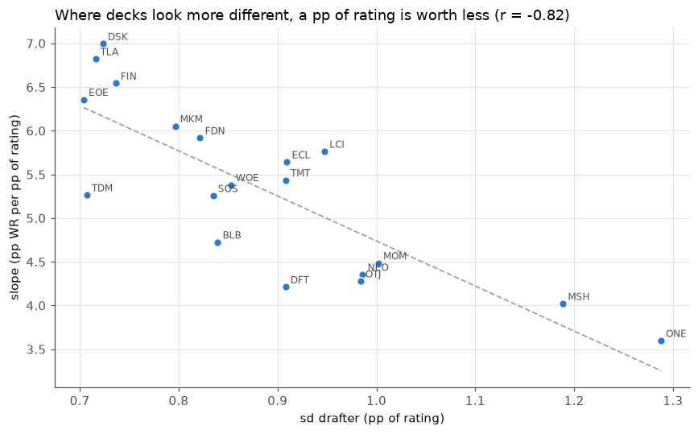
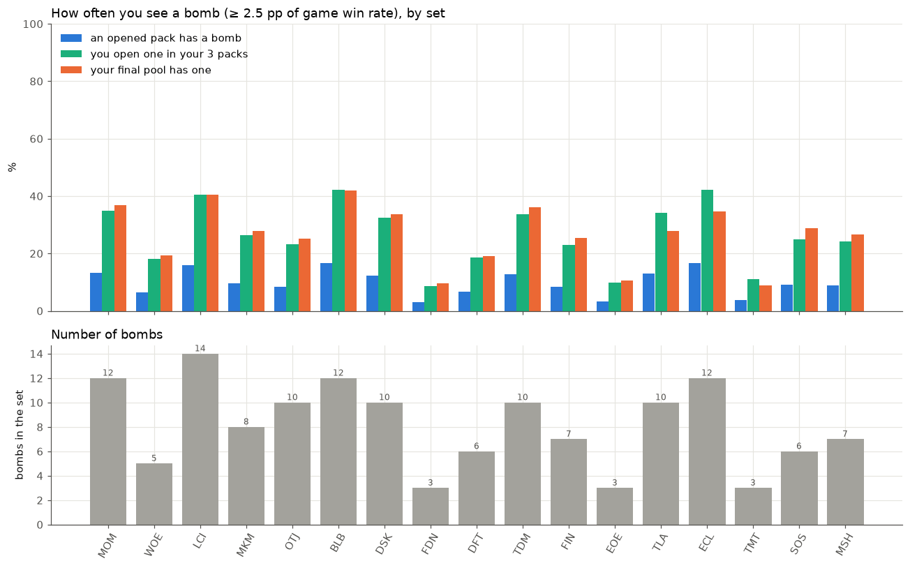

# What Is a Bomb Actually Worth? 14 Million Limited Games, 19 Sets, One Yardstick

*Putting every set's best cards on the same scale, how often you'll actually see one, and which formats are decided by rares*

---

Every Limited player knows the feeling. You crack your first pack, and there it is: a mythic that will just win the game if it resolves. A **bomb**.

But "bomb" is a slippery word. Is Bonehoard Dracosaur in Lost Caverns the same kind of bomb as Liliana, Dreadhorde General in Foundations? Do some sets have more of them? How often do you actually open one, and how often does one end up in your deck? And when people call a format "rare-driven," is that the same thing as having lots of bombs?

I tried to answer those questions with data: **19 sets of 17Lands Premier Draft data**, from Kamigawa: Neon Dynasty (Feb 2022) to Marvel Super Heroes, about **14 million games**. This post walks through what I did and what came out. The short version:

- **A set's best card is worth about +4.4 percentage points of game win rate per copy** compared with an average card in the same deck. The 10th-best card is worth about +2.3.
- Defining a bomb as **≥ 2.5 pp of game win rate per copy** gives about **8 bombs per set**, from 3 (Foundations, Edge of Eternities, TMNT) to 14 (Lost Caverns).
- **One opened pack in eleven** has a bomb. You open one in your own three packs about **a quarter** of the time.
- "Prince" formats, where rares decide games, are **not** the same thing as bomb-heavy formats. Across sets the two barely correlate.

---

## Part 1: Rating cards

### Start with GIH WR, but fix the baseline

The obvious per-card number is 17Lands' **GIH WR**: the win rate of games where the card was in your opening hand or drawn. Two fixes are needed before it can be compared across sets.

**The baseline moves.** 17Lands users are better than the average Arena player, so they win about 55% of their games, not 50%, and the exact figure depends on the set (54.1% in Outlaws, 56.8% in TMNT). A 58% GIH WR card is good in one set and merely fine in another. So I subtract the set's average and rate each card in **percentage points above the set baseline**.

**Small samples lie at the extremes.** The noisiest cards end up disproportionately at the top and bottom of the list, so I shrink every card toward the average for its rarity (an *empirical Bayes* adjustment). Cards with lots of data barely move; cards with little data get pulled toward the middle. Shrinking toward the *rarity* average, not one shared average, keeps the real bombs from being dragged down.

Why not **IWD** (GIH WR minus the win rate when the card sat in the deck unseen)? I tested both: rate each deck by the average rating of its cards and see which one better predicts wins. **GIH WR won on all 19 sets.** IWD answers "is drawing this card better than not drawing it, in this deck?", which isn't the same as "do decks with this card win?"

## Part 2: Deck score, and the ruler problem

For every game, I scored the deck as the **average rating of its nonbasic cards**. To keep it honest, the scoring is *cross-fitted*: I split drafts into two random halves and score each half using card ratings computed only from the other half. Otherwise a deck's own wins would leak into its score.

*Game win rate by deck score, relative to each set's average. Thin lines are individual sets, the thick line pools them.*

Deck score predicts wins cleanly. **One standard deviation of drafter deck quality is worth about 4.6 pp of game win rate**, and deck card strength explains about **a third** of the real spread in drafters' win rates (0.20 to 0.47 by set). The other two thirds is play skill, mulligans, synergy and everything else a card list doesn't capture.

### One point of rating isn't worth the same everywhere

Here's the catch. The conversion from rating to win rate, the slope, varies a lot by set: **from 3.6 pp of win rate per pp of rating in Phyrexia: All Will Be One to 7.0 in Duskmourn.**

*Each dot is a set. Where deck scores spread wider, each point of rating is worth less.*

The slope is lowest exactly where decks *look* most different, and the two offset each other. A wider pool of opponents can't explain a 2× difference (a simple model gives 1 to 2%). The likely explanation is that **the rating scale itself stretches from set to set**: part of a card's GIH WR spread is which players pick it, which games it shows up in, and noise. When there's more of that, decks look more different without being more different. That matters for bombs.

## Part 3: The usual bomb rule, and why it breaks

The standard way to call a card a bomb is to call it an outlier in its own set, using the **Tukey upper fence** (third quartile plus 1.5× the interquartile range). If ratings were normal, about one card per set would clear it. In fact 90 cards across 19 sets do, against about 19 expected: bombs really do stand apart.

But the fence measures each card against *its own set's spread*, and that spread is on a different scale in every set. Foundations has zero fence bombs; Lost Caverns and Avatar have ten each. Is that a real difference between sets, or a difference in rulers?

## Part 4: Bombs in win rate, on one scale

To fix it, I measured each card directly in the unit we actually care about: **game win rate**.

### The method

For each card in each set, I ran a regression over every Premier Draft game:

> **won** ~ copies of the card + deck score without that card + controls

- **Copies of the card** in the main deck. Its coefficient is the answer: pp of game win rate per copy.
- **Deck score with the card left out.** Bombs tend to sit in decks that are good for other reasons too. Holding the rest of the deck's quality fixed means the card is compared with *an average card from the same deck*.
- **Controls:** the drafter's overall win-rate bracket (from 17Lands), so "good players take this card" doesn't count as card strength; the deck's colors; play or draw; and how many rated cards the deck has.

Standard errors are clustered by draft, cards seen in fewer than 500 decks are dropped, and estimates are again shrunk toward the set-and-rarity average. I call the result a card's **impact**.

### What a card is worth

- **A set's best card: about +4.4 pp per copy** (median), from +3.2 in Foundations to +5.4 in Lost Caverns.
- **5th best: +3.1. 10th best: +2.3.**
- Commons sit around −0.4, uncommons around 0, and the median rare or mythic that nobody called a bomb is about +0.3.

Top cards are also worth up to about 1.5× more than you'd get by converting their rating through the deck-score slope, and bad cards cost less (the direct estimate levels off around −0.7 pp).

### The ruler, confirmed

If sets with flat slopes really had weaker cards, their top cards' direct impact would be lower. It isn't: the impact of each set's 1st, 5th and 10th best card **doesn't correlate with the slope or the rating spread at all** (r between −0.10 and +0.15). The slope differences were a ruler, not a difference in card power.

### The definition

> **A bomb is a card worth at least 2.5 pp of game win rate per copy, compared with an average card of the same deck.**

Why 2.5? It sits between a typical set's 5th and 10th best card, and it lines up with community opinion. I compiled a list of cards the Limited community called bombs in each set, separated into calls made *before* release (set reviews, early tier lists) and *after* (retrospectives, guides). Of the cards called bombs both before and after release, **72% clear 2.5 pp**. Of all the other rares and mythics, **2%** do. Cards hyped before release and then downgraded have a median impact of only +0.9, and *none* of them clear 2.5.

(Post-release opinion is partly built from 17Lands data, so that agreement isn't independent. Pre-release-only calls land at a median of +2.2 pp: reviewers spot most bombs and miss on some.)

This gives **153 bombs across 19 sets: median 8 per set**, 70 mythics and 83 rares. No common or uncommon makes it.

The biggest bombs of the past four years:

| Card | Set | Impact (pp per copy) |
|---|---|---|
| Bonehoard Dracosaur | LCI | +5.4 |
| Aclazotz, Deepest Betrayal | LCI | +5.3 |
| Jeskai Revelation | TDM | +5.1 |
| Aurelia's Vindicator | MKM | +4.9 |
| Captain Marvel, Earth's Protector | MSH | +4.9 |
| Gruff Triplets | WOE | +4.9 |
| Jugan Defends the Temple | NEO | +4.9 |
| Marang River Regent | TDM | +4.8 |
| Ugin, Eye of the Storms | TDM | +4.8 |
| Sab-Sunen, Luxa Embodied | DFT | +4.8 |

And how sets compare:

| Bombs | Sets |
|---|---|
| 12–14 | **LCI (14)**, MOM, BLB, ECL (12) |
| 10 | OTJ, DSK, TDM, TLA |
| 6–8 | ONE, MKM (8); NEO, FIN, MSH (7); DFT, SOS (6) |
| 3–5 | WOE (5); **FDN, EOE, TMT (3)** |

Foundations is the clearest low end: its three bombs are Liliana, Dreadhorde General (+3.2), Curator of Destinies (+2.7) and Embercleave (+2.5), and its best card is the weakest #1 in the data. Lost Caverns of Ixalan is the opposite: 14 cards clear the bar, and 11 clear 3 pp.

Comparing with the fence rule: 85 of the 90 fence bombs are also impact bombs, so the fence wasn't *wrong* about which cards are great. It was wrong about *how many*, because its bar moved with each set's ruler.

### How often do you actually see one?

Using 17Lands draft logs (available for 17 of the 19 sets), I counted how often packs and pools contain a bomb.

Median across sets:

- **9% of opened packs contain a bomb.** About one pack in eleven.
- **25%: you open at least one in your own three packs.**
- **90%: someone at the 8-player table opens one.** On average there are about 2.2 bombs opened per pod.
- **28% of 17Lands drafters end with a bomb in their pool. Only 4% get two.**

So in a typical draft there are two or three bombs going around the table, and you have about a one-in-four shot at ending up with one. It ranges widely by set: in Foundations and Edge of Eternities only about 10% of drafters finish with a bomb, while in Bloomburrow and Lost Caverns it's over 40%. Across sets, the bomb count predicts the chance of finishing with one almost perfectly (r = 0.93).

17Lands users usually end up with slightly more than their fair share of the table's bombs (about 1.09×). Avatar, Lorwyn Eclipsed and TMNT are exceptions at about 0.8, and I don't yet know why.

---

## Part 5: Prince or pauper?

Limited players sort formats on a **prince–pauper** axis:

- In a **prince** format, rares decide games. Commons and uncommons are fairly flat, and you have to answer the opponent's rares or lose. Theros Beyond Death and Crimson Vow are the textbook examples (neither is in my data).
- In a **pauper** format, commons and uncommons decide games: synergy, tempo, efficient common removal.

It's tempting to treat this as the same thing as being bomb-heavy. It isn't. **Bomb-heavy** is about the *count* of game-winning cards. **Prince** is about *where the difference between decks comes from*. A set can have lots of bombs and also strong commons that keep up, or few bombs and commons so flat that whatever rares you open still decide who has the better deck.

### Measuring it

Using each card's impact, I computed for every Premier Draft deck:

- **V** = the total value of its cards,
- **R** = the part of V coming from rares and mythics.

The **rare share** is Cov(R, V) / Var(V): the fraction of the deck-to-deck variation in card value that comes from rares and mythics. It and the common/uncommon share add up to one.

Labels are relative to these 19 sets, so "prince" means "most rare-driven of these," not "as rare-driven as Theros": **prince** at a rare share of 0.36 or more, **pauper** at 0.28 or less.

| Label | Sets (rare share) |
|---|---|
| **Prince** | TLA (0.43), TDM (0.41), MKM (0.40), DSK (0.39), OTJ (0.38), MSH (0.37) |
| Middle | EOE (0.35), WOE (0.34), ECL, DFT (0.31), LCI (0.30), MOM (0.29), TMT (0.28) |
| **Pauper** | BLB (0.26), FDN, SOS (0.25), FIN (0.24), ONE (0.20), NEO (0.19) |

In Avatar, rares and mythics account for 43% of what separates decks. In Neon Dynasty, 19%.

### Prince is not bomb-heavy

*Each set by its bomb count and its rare share. Dashed lines are the medians.*

Across sets, bomb count and rare share correlate at only **r = +0.19**. All four corners are filled:

- **Prince and bomb-heavy:** Avatar, Tarkir: Dragonstorm, Duskmourn, Outlaws. Lots of bombs, and the commons don't keep up.
- **Bomb-heavy but not prince:** Lost Caverns (the most bombs in the data at 14), March of the Machine, Lorwyn Eclipsed, Bloomburrow. Plenty of bombs, but the commons and uncommons are strong enough that they still drive most of the difference between decks. Bloomburrow, with 12 bombs, is *pauper*.
- **Rare-driven without many bombs:** Marvel, Edge of Eternities and Wilds of Eldraine. Few true bombs, but flat commons, so whatever rares you open still separate decks.
- **Neither:** Foundations, Strixhaven, Final Fantasy.

### What makes a set prince?

If "prince" just meant "rares are much stronger than commons," it would track how much better the *typical played* rare is than the typical played common. It barely does (r = 0.16). What matters instead:

| Feature | Correlation with rare share |
|---|---|
| Spread of common/uncommon values | **−0.64** |
| Gap between the best 10 rares and best 10 commons/uncommons | **+0.67** |
| Strength of the best 10 commons/uncommons | **−0.50** |
| Rares per deck | +0.49 |
| Number of bombs | +0.19 |

The strongest predictor isn't how good the rares are. It's **how flat the commons and uncommons are.** When commons all play at about the same level, drafting them well doesn't separate you from the next player, and the rares do the separating. When there are standout commons and uncommons, getting them matters as much as your rares.

There's also a mechanical factor: **Play Boosters** (Murders at Karlov Manor onward) put more rares in each pack. More rares per deck mechanically raises the rare share, and all six prince sets are Play Booster sets.

### One more axis: deep or shallow

How far down do decks reach for their last playables? I measured it two ways: how far a deck's three weakest cards fall below its average, and how many on-color cards at least that good were left on the bench. The ranking:

- **Deep:** ECL, TMT, TLA, WOE, LCI, TDM
- **Shallow:** FIN, FDN, ONE, OTJ, SOS, BLB

Nobody actually runs out: in every set, 98%+ of decks leave a comparable playable on the bench. Sets differ in *how good* the last cards are. And **pauper formats tend to be shallow** (r = +0.49 with rare share; five of the six pauper sets are shallow). When decks fill out with weak commons, which commons you got matters more. Depth isn't flatness or bomb count, though: Lorwyn Eclipsed has the widest common/uncommon spread and 12 bombs, and is still the deepest set.

---

## Putting it together

1. **A bomb is worth about 3 to 5 points of win rate per copy.** Over a Premier Draft run, that's real but not decisive. Deck card strength as a whole explains only about a third of the spread in drafters' results.
2. **Bomb counts vary a lot by set, and it shows in your pool.** In Lost Caverns or Bloomburrow, about 40% of drafters end with a bomb. In Foundations or Edge of Eternities, about 10%. Calibrate how hard you chase a first-pick rare accordingly.
3. **"This set has a lot of bombs" and "this set is decided by rares" are different claims.** Bloomburrow had 12 bombs and was still a commons format. Edge of Eternities had 3 and was among the most rare-driven. If you want to know whether to prioritise rares over strong commons, look at how flat the commons are, not at how many bombs there are.
4. **Don't compare raw win-rate ratings across sets.** A point of GIH WR is worth twice as much in some sets as in others. If you want to compare cards across formats, measure them in win rate directly.

---

### Methodology notes and caveats

- **Data:** 17Lands Premier Draft, 19 sets (NEO to MSH), about 14 million games. No draft logs for NEO and ONE.
- **Population:** 17Lands users are above-average drafters; results describe their games, not the average Arena player's.
- **Selection:** build-arounds and hard-to-cast cards are measured in the decks that play them. A bomb can also pull you into its colors, which the estimate doesn't count.
- **Skill control** includes the games being analyzed, so it slightly over-controls. True bomb values are, if anything, a bit higher.
- **Labels** (prince/pauper, deep/shallow) are relative to these 19 sets, and neighbours often differ by 0.01. Treat the borders as soft.

*All code and results are in the repo: the card ratings and deck scores in `notebooks/bombs.ipynb`, the win-rate impact model in `scripts/card_impact.py` and `notebooks/card_impact.ipynb`, the prince index in `scripts/prince_index.py`, and depth in `scripts/depth_index.py`.*
